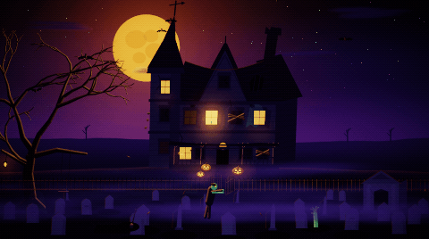
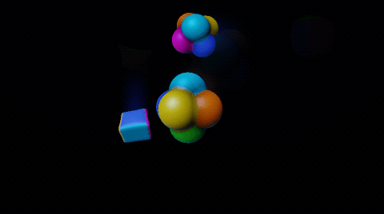
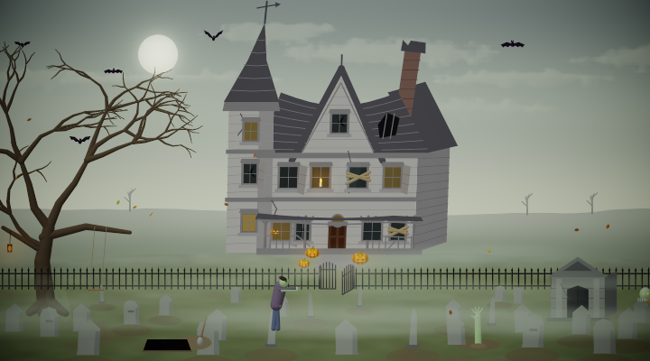
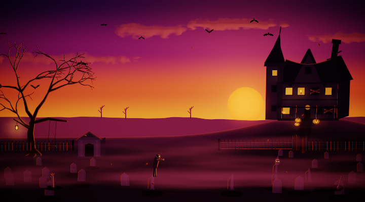
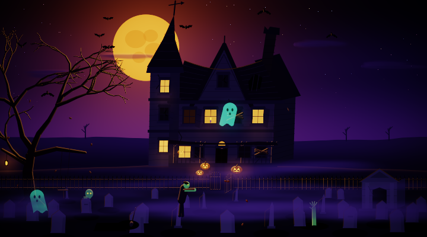
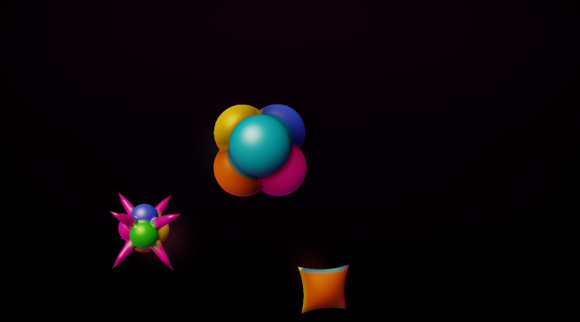
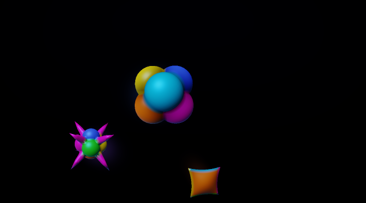

# OpenCode Wallpapers

Animated wallpapers for the OpenCode terminal UI: slow, quiet scenes behind everything, kept readable behind text.


> This project is not affiliated with, endorsed by, or sponsored by OpenCode or its maintainers.

## Install

Requires OpenCode 2. Clone into OpenCode's plugin directory and restart OpenCode:

```sh
git clone https://github.com/vaprdev/opencode-wallpapers.git ~/.config/opencode/plugins/wallpapers
```

Update with `git pull`.

## Use

Type `/wallpaper` to open the menu. ↑/↓ picks a setting, Enter or ←/→ changes it, Escape closes it.


- **Activity:** calm, lively or teeming: how much moves behind your work.
- **Time:** day, sunset or night, or auto to follow your clock.
- **Season and weather:** follow the calendar, or the real weather where you are (`/wallpaper location Berlin`).
- **Brightness, shuffle, per project and power:** subtle to vivid, a new wallpaper every hour, one per project, and
  slowing down when idle.

Scenes react to your agent: they speed up while it works, a visitor shows up when it finishes, and clouds roll in after
an error. With mouse support, clicking empty background nudges the scene, and each wallpaper hides a rare surprise.

## Wallpapers

`ocean` · `desert` · `jungle` · `space` · `farm` · `tundra` · `beach` · `city` · `zen` · `prehistoric` · `rider` ·
`megacity` · `dome` · `haunted-house` · `flowerbox`

| Spring | Summer | Autumn | Winter |
| --- | --- | --- | --- |
|  |  |  |  |


## Terminals

Any truecolor terminal works. Ghostty and kitty get finer octant characters; others get quadrant blocks.

| Variable | Effect |
| --- | --- |
| `WALLPAPER_PIXELS=1` | In Ghostty or kitty, draw the scene as a real image |
| `WALLPAPER_SUPERSAMPLE=2` | Smoother edges, at about 2.5x the CPU |
| `WALLPAPER_OCTANTS=0` or `1` | Force quadrant or octant characters |
| `WALLPAPER_SMOOTH=0` | Octants without wedges and eighth blocks |
| `WALLPAPER_LOCATION` | A place or `latitude,longitude` for local weather |

## Make a wallpaper

See [CONTRIBUTING.md](CONTRIBUTING.md).

## Gallery

At teeming, played back at 3x speed:

| | |
| --- | --- |
|  |  |
|  |  |
|  |  |
|  |  |
|  |  |
|  |  |
|  |  |
|  | |

| | Day | Sunset | Night |
| --- | --- | --- | --- |
| Ocean |  |  |  |
| Desert |  |  |  |
| Jungle |  |  |  |
| Space |  |  |  |
| Farm |  |  |  |
| Tundra |  |  |  |
| Beach |  |  |  |
| City |  |  |  |
| Zen garden |  |  |  |
| Prehistoric |  |  |  |
| Rider |  |  |  |
| Megacity |  |  |  |
| Dome |  |  |  |
| Haunted house |  |  |  |
| Flower Box |  |  |  |

## License

[MIT](LICENSE)
